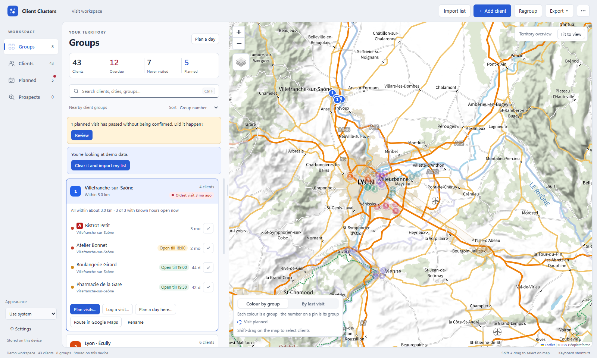

# Client Clusters

Desktop app (Windows) that reads a client list, places clients on a map, groups them by proximity
(maximum group size adjustable, 6 by default) and keeps a log of visits.



**Stack:** Electron (sandboxed renderer, context isolation, strict CSP), vanilla JavaScript, Leaflet,
SheetJS, JSZip. Geocoding via IGN Géoplateforme and OpenStreetMap Nominatim; optional Google Places API (New).

**Privacy:** the repository holds no client data. All data stays on the user's computer
(`%APPDATA%\client-clusters`); the Google API key is encrypted with the OS account (Electron `safeStorage`).
Use **Try with demo data** on the start screen to explore the app with fictional clients.

## Using it

1. **Import list** — choose an Excel (.xlsx/.xls), CSV, or KMZ/KML file (Google Earth / Google My Maps export;
   pins keep their exact position, KMZ layers are kept as a "Folder" field). The app guesses which column is the
   name, street address, postal code, city, and optionally country, latitude/longitude, last-visit date
   and notes. Check the mapping and click **Import**. Other columns are kept and shown on each client's card.
2. Addresses are placed on the map automatically (internet needed). French addresses use the official
   IGN/Base Adresse Nationale service; other countries use OpenStreetMap. Results are cached.
   Clients whose address can't be found are named in the sidebar: **Review and fix** lists them with the address
   that was searched, lets you correct it and search again, place the client on the map yourself,
   or look the address up in Google Maps.
3. Clients are grouped automatically. **Regroup** recomputes the groups at any time (visits are kept).
   Rules (… menu → Settings): up to 6 clients per group, or up to 8 when they are all in the same town
   (towns are kept together); no two clients in a group more than 50 km apart. Group sizes therefore vary;
   a town with more clients than the same-town limit is split by neighbourhood.
   Groups are named automatically after their main towns (up to 3, e.g. "Annecy · Seynod · Cran-Gevrier"),
   and the names update whenever clients move between groups. Groups that would share a name are told
   apart by arrondissement / postcode or direction ("Lyon 3e", "Annecy – West"). Clients without a city
   (KMZ pins, pins placed by hand) get their town looked up from their position.
   **Rename** sets your own name, which is kept; *Use automatic name* switches back.
   Settings also set when a visit becomes *due* / *overdue*.
4. Noting visits:
   - in a group, tick ✓ next to a client to mark it visited today (click again to undo);
   - **Log a visit…** records one date and note for several clients of a group at once;
   - a client's card lets you add a visit on any date with a note, and delete visits.
5. **Route in Google Maps** opens a driving route through a group's clients (from home and back when a home
   address is set).
6. **Export ▾ → Excel** writes three sheets: Clients (with group, last visit, opening hours, Google page), Groups, and the full Visits log.
   **Export ▾ → Google Earth / My Maps (.kmz)** writes one layer per group with pins in the group's colour;
   the file can be imported back into the app without creating duplicates.
7. **Home address** (… menu → Settings): groups are numbered by distance from home — group 1 is the nearest
   (straight line from home to the middle of the group). Numbers stay up to date when groups change; the
   distance shows on each group. Without a home address groups are numbered north to south.
8. **Opening hours** (… menu → Opening hours…): with a Google Maps Platform API key (Settings; "Places API (New)"
   enabled), each client is searched on Google by name and address and linked to its Google business page when
   one result is a sure match (same name, at the address). Opening hours, phone and website then show on the
   client's card, "Open till 18:30" / "Opens 14:00" shows next to each client of a group, and hours are updated
   every 90 days (adjustable). Clients without a sure match are listed in **Review and choose**: pick the right
   business, search with other words, paste the link of its Google Maps page, mark it as having no Google page,
   or type the hours by hand (also possible without any API key). A "Google Maps link" column in an imported
   file is used directly. The key is stored encrypted in `google.json` in the data folder, not in backups.

Re-importing an updated list with *Add to my list* updates existing clients (same name + address)
and keeps their visit history.

## Planning visits (1.7)

- **Planned, done or didn't happen.** A visit dated in the future is *planned*. When its day has passed it is listed as
  *not confirmed* (sidebar note and **Planned** tab) until you mark it **Done**, **Didn't happen** or **Move** it to another day.
  Only done in-person visits count as the last visit; ticking ✓ on the day of a planned visit confirms it.
- **Type and outcome.** Each visit can be a visit or a phone call, with an outcome (went well, order taken, follow-up needed,
  nobody available, closed on arrival). Calls and visits where nobody was met are kept in the history but don't count as the last visit.
- **Priority A / B / C.** Each client can have a priority with its own *due* / *overdue* delays (… → Settings). Set it on the
  client's card, with a "Priority" column in an imported file, or for several clients at once (select them on the map).
- **Planned tab.** The next two weeks day by day (and any later day with visits): stops in visiting order, estimated arrival
  times, and the client's opening hours at that time ("Opens 14:00", "Closed on Mondays"). Click a day to see its route on the
  map; drag a visit onto another day (or onto another visit to change the order). **Best order** re-orders the stops to drive
  less and arrive while clients are open. **Route in Google Maps** splits long days into parts (Google takes 9 stops at most).
- **Plan a day…** picks the clients that most need a visit in one area (automatic, around a group, or the clients selected on
  the map), keeps what is already planned that day, leaves out clients closed that day, and fits the visits in the working day
  (Settings → Day planning). Click × on a proposed client to get another one instead.
- **Select on the map.** Shift-drag a box (or ctrl-click pins) to select clients, then plan or log visits for them, plan a day
  with them, or set their priority.
- **Excel export** has a *Planned* sheet; the *Visits* sheet holds the history with status, type and outcome.

## Where data is stored

`%APPDATA%\client-clusters\clients.json` (… menu → *Open data folder*). A daily backup is kept in the
`backups` sub-folder (last 14 days).

## Moving to another computer

1. On the old computer: … menu → **Save a backup…** It writes one `.ccbackup` file (to Documents by default) with
   all clients, visits, groups, opening hours, settings, home address and the addresses already found. Tick
   *Include my Google API key* to carry the key too: it is encrypted with a password you choose.
2. Copy the file to the other computer (USB key, OneDrive, e-mail…).
3. On the other computer: … menu → **Restore a backup…** (or the *Restore a backup* button on the start screen).
   The window shows when and where the backup was made and what it contains, then lets you choose:
   - **Combine** — adds the backup's clients and visits to the ones already there. Nothing is removed; a client
     on both computers (same client, or same name and address) keeps the visits of both.
   - **Replace** — the computer gets exactly the backup's data.
   Before anything changes, the current data is saved as `backups\before-restore-….json`, which can itself be
   restored the same way. Backups made with older versions (`.json`) can be restored too.

## Running from source

Requires Node.js 20+.

```
npm install
npm start          # run the app
npm test          # run core and main-process regression tests (no network)
npm run test:smoke # run the sandboxed Electron renderer with isolated demo data (no network)
npm run dist:win   # build the full Windows .7z install and an update-only .zip
```

Code: `src/main.js` (files, import/export, geocoding), `src/renderer/app.js` (interface),
`src/renderer/hours.js` (opening hours and Google matching), `src/renderer/planning.js` (stop order, arrival times, day planner, Google Maps route links), `src/renderer/cluster.js` (grouping: towns form blocks, blocks are merged closest-first under the size and
distance limits; big towns are split with capacity-limited k-means).

## License

[MIT](LICENSE) © 2026 Maxime Vignals. Leaflet (in `src/vendor/leaflet`) is under its own
[BSD 2-Clause license](src/vendor/leaflet/LICENSE).
